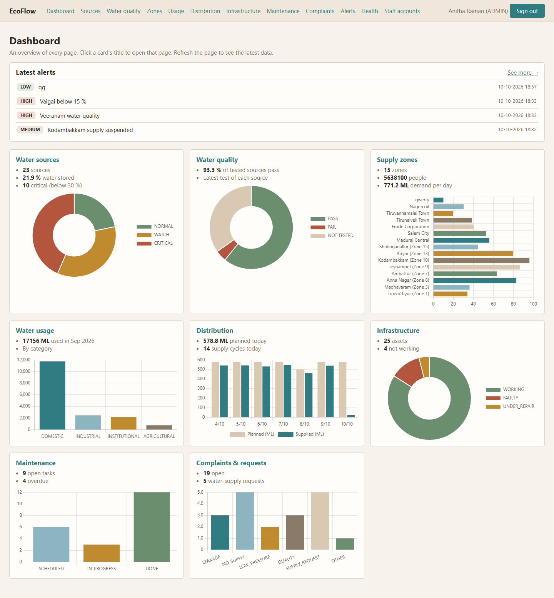
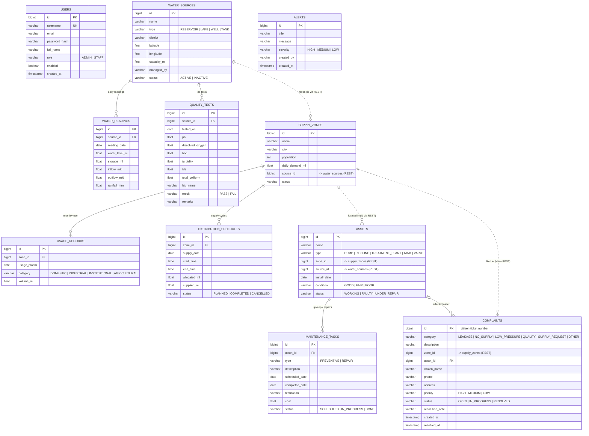
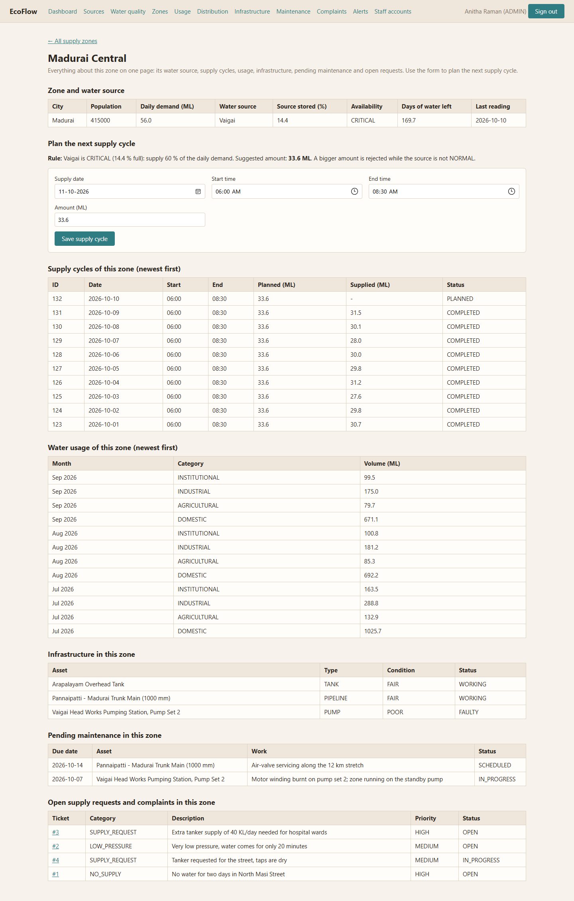

# EcoFlow: Integrated Water & Natural Resource Management (Tamil Nadu)

EcoFlow is a Spring Boot microservices web application for a water authority. It covers water sources and their levels, water
quality, consumption, distribution schedules, infrastructure and maintenance, public complaints and requests, and staff alerts.
It runs on real Tamil Nadu reservoir and lake data.

**Every working page has a form that saves to the database and a table that shows the saved
data**, newest first. The dashboard gives an overview of every page with Chart.js graphs, and `/health` shows whether each
microservice is running.

**Stack:** Java 21 · Spring Boot 4.1 (MVC, Data JPA, RestClient) · PostgreSQL · Thymeleaf · Chart.js (dashboard graphs)



**Contents**

- **Part A: Developer workflow**: [Architecture](#a1-architecture) · [Run it](#a2-run-it) · [Project layout](#a3-project-layout) ·
  [Page pattern](#a4-the-page-pattern-form--table) · [Database architecture](#a5-database-architecture) · [REST APIs](#a6-rest-apis) ·
  [Alerts](#a7-alerts) · [Data sources](#a8-data-real-vs-sample) · [Recipes](#a9-recipes) ·
  [Troubleshooting](#a11-troubleshooting)
- **Part B: User workflow**: [Roles](#b1-roles) · [Staff workflow](#b2-staff-workflow) · [Citizen workflow](#b3-citizen-workflow)

---

# Part A: Developer workflow

## A1. Architecture


| App | Port | Owns | Database |
|---|---|---|---|
| `web-app` | 8000 | Thymeleaf pages (MVC), login; calls the four services over REST | none |
| `user-service` | 8081 | Staff accounts, login check (BCrypt) | `user_db` |
| `water-service` | 8082 | Water sources, daily level readings, quality tests | `water_db` |
| `supply-service` | 8083 | Supply zones, usage per category, distribution schedules, allocation plan | `supply_db` |
| `operations-service` | 8084 | Assets, maintenance, complaints and supply requests, alerts | `operations_db` |

How the design maps to the assignment:

| Requirement | Where |
|---|---|
| Spring Boot MVC | `web-app`: `controller/` (C), `templates/` (V), client records (M) |
| Microservices + REST between them | Four services, each with its own database. `web-app` calls all four; `supply-service` calls `water-service` (`supply-service/.../client/WaterClient.java`). |
| Spring Data JPA + PostgreSQL | Every service: `model/` (entities) and `repository/` (Spring Data interfaces) |
| Thymeleaf | `web-app/src/main/resources/templates`, one file per page |
| Loose coupling | Database per service. Services never share code or tables, only JSON. URLs come from configuration. |

## A2. Run it

**You need:** JDK 21 or newer (`java -version`), and Docker **or** a local PostgreSQL (14+). Maven is included (`mvnw`).

**Option A: Docker** (simplest)

```powershell
.\scripts\start-all.ps1 -Docker     # starts PostgreSQL, builds, opens one window per app, waits until all are healthy
```

**Option B: PostgreSQL already installed**

```powershell
copy .env.example .env              # then put your postgres password in .env
.\scripts\init-local-db.ps1         # creates user_db, water_db, supply_db, operations_db (safe to re-run)
.\scripts\start-all.ps1
```

Then open:

| What | URL |
|---|---|
| Staff app | http://localhost:8000. Sign in as `admin / admin123` (admin) or `staff / staff123` (officer) |
| Citizen pages (no login) | http://localhost:8000/report and http://localhost:8000/track |
| API docs (Swagger) | http://localhost:8081/swagger-ui/index.html (and 8082, 8083, 8084) |
| Health | `/health` on dashboard page(Only for admin and staff) |

- **Stop everything:** `.\scripts\stop-all.ps1`.
- **First start:** each service fills its empty tables with the Tamil Nadu data (see [A9](#a9-data-real-vs-sample)).
- **macOS/Linux, or one service at a time:** start each app in its own terminal, in this order (`water-service` before `supply-service`):
  ```bash
  ./mvnw -pl user-service spring-boot:run
  ./mvnw -pl water-service spring-boot:run
  ./mvnw -pl supply-service spring-boot:run
  ./mvnw -pl operations-service spring-boot:run
  ./mvnw -pl web-app spring-boot:run
  ```
- **Build only:** `./mvnw -DskipTests package`.

## A3. Project layout

```
EcoFlow/
├── pom.xml                      parent POM: Spring Boot version, module list
├── user-service/   water-service/   supply-service/   operations-service/   web-app/
├── docker-compose.yml           PostgreSQL 17 for the whole team
├── docker/postgres/init.sql     creates the 4 databases
├── scripts/                     start-all / stop-all / init-local-db (PowerShell)
├── README.md
```

Every **backend service** has the same layers. A request flows top to bottom:

```
controller/   @RestController: JSON in, JSON out. No business logic.
dto/          request/response records + validation (@NotBlank, @Pattern ...)
service/      business rules (@Service, @Transactional) - the place to read first
repository/   Spring Data JPA interfaces: method names become SQL
model/        @Entity classes = tables (indexes are declared here with @Index)
client/       (supply-service only) REST client for water-service
config/       CsvDataLoader (fills empty tables from resources/data/*.csv), RestClient bean, URLs
exception/    GlobalExceptionHandler -> {"status":400,"detail":"..."} errors
```

The **web-app**:

```
controller/   one @Controller per page: GET shows the form + table, POST saves and redirects back
client/       one class per microservice + the JSON records it uses (UserClient, WaterClient, ...)
security/     login is checked by user-service over REST
templates/    one Thymeleaf file per page; fragments/layout.html = <head>, top bar, success/error message
static/       css/app.css (the only stylesheet), js/charts.js (3 small Chart.js helpers), favicon.svg
```

## A4. The page pattern (form + table)

Every working page (all pages except the dashboard and `/health`) is built the same way:

1. **A form** (`<form class="entry" method="post">`) with labelled inputs and one Save button.
2. **The controller** receives it as a record (`@ModelAttribute WaterClient.SourceForm form`) and sends it to the microservice.
   It puts a success or error text in a flash message, then redirects back to the same page.
3. **The table** shows the data from the database, **newest first**, so the record just saved is the first row.
4. **Missing values** are shown as a hyphen with a plain `if` in the template:

```html
<td th:text="${s.storageMl != null ? s.storageMl : '-'}"></td>
```

An empty text box is saved as "no value" (`null`), not as an empty text: `GlobalModelAdvice.emptyTextToNull()` does that for
every form.

| Page | URL | Form (saves to) | Table |
|---|---|---|---|
| Dashboard | `/dashboard` | (none: overview only) | The 5 newest alerts (click one or "See more" to open `/alerts`), then one card per page with key numbers and a chart |
| Health | `/health` | "Check again" button | Each microservice: address, Running / Not running, response time |
| Sources | `/sources` | Add a water source | All sources with their latest level |
| Source readings | `/sources/{id}` | Record a reading | Current level + latest 30 readings |
| Water quality | `/quality` | Record a lab test | All tests |
| Zones | `/zones` | Add a supply zone | All zones |
| Zone situation | `/zones/{id}` | Plan the next supply cycle | Source, cycles, usage, assets, pending maintenance, open requests |
| Usage | `/usage` | Record usage | Latest 50 records |
| Distribution | `/schedules` | Plan a supply cycle | Latest 50 cycles |
| Infrastructure | `/assets` | Add an asset | All assets |
| Maintenance | `/maintenance` | Add a task (plus a "Mark done" button per open task) | All tasks |
| Complaints | `/complaints` | Register a complaint | All complaints and requests |
| Ticket | `/complaints/{id}` | Update status / priority / resolution | Ticket details |
| Alerts | `/alerts` | Add an alert | All alerts |
| Staff accounts (admin) | `/users` | Add an account (plus Delete per row) | All accounts |
| Report (public) | `/report` | Report an issue / request water | 10 newest tickets (no names or phones) |
| Track (public) | `/track` | Ticket number + mobile | That ticket |

## A5. Database architecture

**11 tables in 4 databases.** Solid lines are real foreign keys inside one database. Dotted lines are ids that point into *another
service's* database. Those are not foreign keys; they are checked over REST.



**Notes**

- **How tables are created.** Each service creates its tables from its `@Entity` classes (`spring.jpa.hibernate.ddl-auto: update`).
  There is no SQL script to run.
- **Units.**
  - Volumes are in **ML** (million litres) and flows in **MLD** (ML per day).
  - Published figures were converted once when the CSV files were made: 1 mcft = 28.3168 ML, and 1 cusec = 2.4466 MLD.
- **Fixed values are plain strings.** Codes such as `type`, `status` and `category` are stored as text and checked by `@Pattern` on
  the request DTOs. They are not Java enums: Hibernate adds a database CHECK constraint for enums that `ddl-auto: update` never
  updates, so adding a new value later would break.

**Indexes:** only where a query needs one. PostgreSQL does not index foreign keys automatically; each composite index below
starts with the FK column, so it covers the FK as well.

| Index | Table (columns) | Why it is needed |
|---|---|---|
| `idx_readings_source_date` | `water_readings (source_id, reading_date)` | "Latest reading of each source" runs for every source on the dashboard, sources and zone pages. This is the largest table (60 readings per source). |
| `idx_quality_source_date` | `quality_tests (source_id, tested_on)` | "Latest test of each source" for the quality column and compliance %. |
| `idx_usage_zone_month` | `usage_records (zone_id, usage_month)` | The zone page reads one zone's usage. |
| `idx_schedules_zone_date` | `distribution_schedules (zone_id, supply_date)` | The zone page reads one zone's supply cycles. |
| `idx_complaints_zone_status` | `complaints (zone_id, status)` | The zone page reads one zone's open complaints. |
| `idx_maintenance_status_date` | `maintenance_tasks (status, scheduled_date)` | The dashboard counts open tasks whose date has passed (overdue). |
| unique `username` | `users (username)` | Login lookup. Added automatically by the unique constraint. |

The small tables (`water_sources`, `supply_zones`, `assets`, `alerts`) have no extra index; a full scan of a few dozen
rows is faster than an index.

## A6. REST APIs

All JSON. Lists come back **newest first**. Errors look like
`{"status":400,"detail":"Vaigai is CRITICAL (14.4 % full)... at most 33.6 ML can be allocated..."}`. Try any of them in Swagger UI.

**user-service :8081**

| Method | Path | Purpose |
|---|---|---|
| POST | `/api/auth/login` | Check username and password, return the user (web-app builds the session) |
| GET / POST | `/api/users` | List / create staff accounts |
| GET / DELETE | `/api/users/{id}` | Read / delete an account |

**water-service :8082**

| Method | Path | Purpose |
|---|---|---|
| GET / POST | `/api/sources` (`?availability=CRITICAL` optional) | Sources with latest level, %, availability, days of supply, last quality result / add a source |
| GET | `/api/sources/{id}` | One source with its latest level (also used by supply-service) |
| GET / POST | `/api/sources/{id}/readings` | Latest 30 readings / record a reading |
| GET / POST | `/api/quality-tests` | All tests / record a test. PASS or FAIL is decided by the server. |
| GET | `/api/summary` | Total storage %, counts by availability, quality compliance |

**supply-service :8083**

| Method | Path | Purpose |
|---|---|---|
| GET / POST | `/api/zones` | Supply zones. Creating one checks the source exists via water-service. |
| GET | `/api/zones/{id}` | One zone |
| GET | `/api/zones/{id}/plan` | Suggested allocation for the next cycle (calls water-service) |
| GET / POST | `/api/usage` (`?zoneId=` optional) | Latest 50 usage records (12 for one zone) / record usage |
| GET / POST | `/api/schedules` (`?zoneId=` optional) | Latest 50 cycles (10 for one zone) / plan a cycle. POST enforces the allocation rule. |
| GET | `/api/summary` | Zones, population, demand, today's planned supply, last month's usage by category, planned vs supplied for the last 7 days |

**operations-service :8084**

| Method | Path | Purpose |
|---|---|---|
| GET / POST | `/api/assets` (`?zoneId=` optional) | Infrastructure register |
| GET / POST | `/api/maintenance` (`?zoneId=&openOnly=true` optional) | Maintenance and repair tasks |
| PUT | `/api/maintenance/{id}` | Change a task's status, e.g. `{"status":"DONE"}` (updates the asset status) |
| GET / POST | `/api/complaints` (`?zoneId=` = open ones of that zone) | Complaints and supply requests. POST is used by the public form and the staff form. |
| GET / PUT | `/api/complaints/{id}` | Read / update status, priority, resolution note |
| GET | `/api/complaints/track?id=&phone=` | Citizen status check (phone must match) |
| GET / POST | `/api/alerts` | All alerts / save a new alert |
| GET | `/api/summary` | Asset, maintenance, complaint and alert counts |


## A7. Alerts

- A staff member writes an alert on the **Alerts** page: title, message, severity.
- The web-app adds the logged-in user's name as *created by*, and operations-service saves it in the `alerts` table
  (`POST /api/alerts`).
- Other staff see the new alert **the next time they open or refresh** the Alerts page or the Dashboard (which lists the 5
  newest; clicking one opens the Alerts page).
- There is no cron job, polling, WebSocket, push notification or automatic refresh.

## A8. Data: real vs. sample

The first-start data lives in **CSV files**, one per table, in each service's `src/main/resources/data/` folder:

| Service | CSV files |
|---|---|
| water-service | `water_sources.csv`, `water_readings.csv`, `quality_tests.csv` |
| supply-service | `supply_zones.csv`, `usage_records.csv`, `distribution_schedules.csv` |
| operations-service | `assets.csv`, `maintenance_tasks.csv`, `complaints.csv`, `alerts.csv` |

- **Loading:** on first start, each service's `config/CsvDataLoader.java` copies its CSV files into its **empty** tables. Tables
  that already hold data are never touched.
- **Comments:** lines starting with `#` at the top of each file say where the data comes from and what the columns mean.
- **Relative dates:** dates that should always look current are stored relative to today (`days_from_today`, `months_ago`,
  `created_hours_ago`), so today's supply and overdue work stay up to date whenever you run the demo.
- **Demo logins:** the two accounts (`admin`, `staff`) are created in code by user-service's `config/DataSeeder.java`.
- **To change the data:** edit the CSV (e.g. in Excel, saved as CSV UTF-8), then drop that service's tables or database and
  restart. With Docker, `docker compose down -v` wipes everything.

| Data | Real or sample | Source |
|---|---|---|
| 13 TN reservoirs: capacity, level, storage, inflow, outflow on **10-10-2026** | **Real** | TN Agriculture Dept, "Storage and Flow Data on Major Reservoirs": https://www.tnagrisnet.tn.gov.in/ARS/home/reservoir |
| 6 Chennai lakes: same fields on **09-10-2026** | **Real** | CMWSSB "Lake Storage": https://cmwssb.tn.gov.in/lake-level |
| Mettur's storage 60 days earlier (≈ 46 %, mid-August 2026) | **Real** (WRD figure in news reports) | used as the start of Mettur's history |
| Water quality (pH, DO, BOD, coliform, turbidity, TDS) for Mettur, Bhavanisagar, Vaigai, Papanasam, Poondi, Puzhal and Veeranam | **Real values**, 2023, re-dated to May-Oct 2026 | TNPCB, National Water Quality Monitoring Programme, monthly data 2023: https://tnpcb.gov.in/PDF/About_Us/projects/WaterQuality/WQDJanToDec2023.pdf. Each test's remarks name the original month and station. |
| Zone names (Greater Chennai Corporation zones, other TN cities) and the source that feeds each | Real names | |
| Treatment plant names and capacities (Puzhal 300 MLD, Chembarambakkam 530 MLD, Nemmeli and Minjur desalination, ...) | Real names | CMWSSB |
| The 59 days of level history before each real reading; 2 tanks and 2 well fields; populations; usage; schedules; other assets; maintenance; complaints; 3 example alerts; people and phone numbers (90000xxxxx) | **Sample**, made up but reasonable | marked "Sample data" / "(sample)" in the data |

We also looked at the National Water Data Portal (https://nwdp.nwic.gov.in). Its Tamil Nadu datasets (groundwater levels,
river levels, rainfall) are CSV downloads, and its API page documents no open endpoint, so this demo takes no live feed.

## A9. Recipes

**Add a field to a page:**
1. Add it to the `@Entity` in `model/`, then restart (Hibernate adds the column).
2. Add it to the request record in `dto/` and to the service method.
3. In the web-app, add it to the client's form record and JSON record.
4. Add an `<input>` to the form and a `<th>`/`<td>` to the table, using `${x != null ? x : '-'}`.

**Add a page:**
1. A `@Controller` in `web-app/.../controller/`. Copy `AlertController`: a GET that puts the list in the model, and a POST that
   saves and redirects.
2. A template in `templates/`. Copy `alerts.html`, which has the form on top and the table below.
3. A link in `fragments/layout.html`.

**Call another service from a service:** copy `supply-service/.../client/WaterClient.java` and its bean in `config/RestClientConfig.java`.
Keep only the JSON fields you need in the record and always set timeouts.

**Change the look:** all colours are CSS variables at the top of `web-app/src/main/resources/static/css/app.css`.

**Spring Boot 4 notes** (most tutorials are for Boot 3):
- The starter is `spring-boot-starter-webmvc`.
- Jackson 3 is used. Annotations stay in `com.fasterxml.jackson.annotation`.
- There is no auto-configured `RestClient.Builder`; use `RestClient.builder()`.

---


# Part B: User workflow

## B1. Roles

| Who | How they get in | What they can do |
|---|---|---|
| **Admin** | `admin / admin123` | Everything, plus **Staff accounts** (add, delete) |
| **Staff** (water authority officer) | `staff / staff123` | All other pages: dashboard, sources, quality, zones, usage, distribution, infrastructure, maintenance, complaints, alerts |
| **Citizen** | no account | **/report** an issue or request water, then **/track** the ticket with ticket number + mobile number |

## B2. Staff workflow

Every page works the same way: fill in the form at the top, click **Save**, and the new record appears as the first row of the
table below. A green message confirms the save; a red message explains what was wrong.

1. **Dashboard.** It shows:
   - The 5 newest alerts. Click one, or **See more**, to open the Alerts page.
   - One card per page, each with key numbers, a chart and a title that opens the page:

     | Card | Chart |
     |---|---|
     | Water sources | Normal / watch / critical |
     | Water quality | Pass / fail / not tested |
     | Supply zones | Demand per zone |
     | Water usage | Last month by category |
     | Distribution | Planned vs supplied, last 7 days |
     | Infrastructure | Assets by status |
     | Maintenance | Tasks by status |
     | Complaints & requests | Open tickets by category |
2. **Zones → Open a zone** (the scenario in the problem statement: a zone whose water level has dropped). One page shows:
   - The zone and its water source (level %, availability, days of water left).
   - The rule and the suggested amount, e.g. *"Vaigai is CRITICAL (14.4 % full): supply 60 % of the daily demand. Suggested: 33.6 ML"*.
   - **Plan the next supply cycle**: a form filled with the suggestion. A bigger amount is rejected, with the reason.
   - Tables: the zone's supply cycles, water usage, infrastructure, pending maintenance, and open supply requests and complaints.

   

3. **Sources:** add a source; the table lists every reservoir, lake, well and tank with its latest level. **Open** a source to
   **record a reading** and see its latest 30 readings.
4. **Water quality:** record a lab test. The system decides PASS or FAIL against CPCB Class C and writes which limit failed in
   the remarks.
5. **Usage:** record monthly consumption by category for a zone.
6. **Distribution:** plan a supply cycle for any zone (the same allocation rule applies).
7. **Infrastructure:** add pumps, pipelines, plants, tanks and valves.
8. **Maintenance:** add preventive work or a repair. Click **Mark done** when it is finished; a repaired asset goes back to WORKING.
9. **Complaints:** register a complaint received by phone, or **Open** a ticket to change its status or priority and resolve it
   with a note.
10. **Alerts:** write an alert for the other staff. They see it the next time they open or refresh the page.
11. **Health:** check whether each microservice is running and how fast it answers. Click **Check again** to re-test.
12. **Staff accounts** (admin only): add officers and delete accounts.

## B3. Citizen workflow

1. Open **http://localhost:8000/report**.
2. Choose what it is about: leak, no supply, low pressure, dirty water, **request water** (tanker or new connection), or other.
3. Choose your area, describe the problem, and give your name and 10-digit mobile number. Click **Submit**.
4. Note the **ticket number** in the green message. Your ticket also appears at the top of the "Recent tickets" table.
5. Open **/track** any time and enter the ticket number and mobile number to see its status and what was done.
